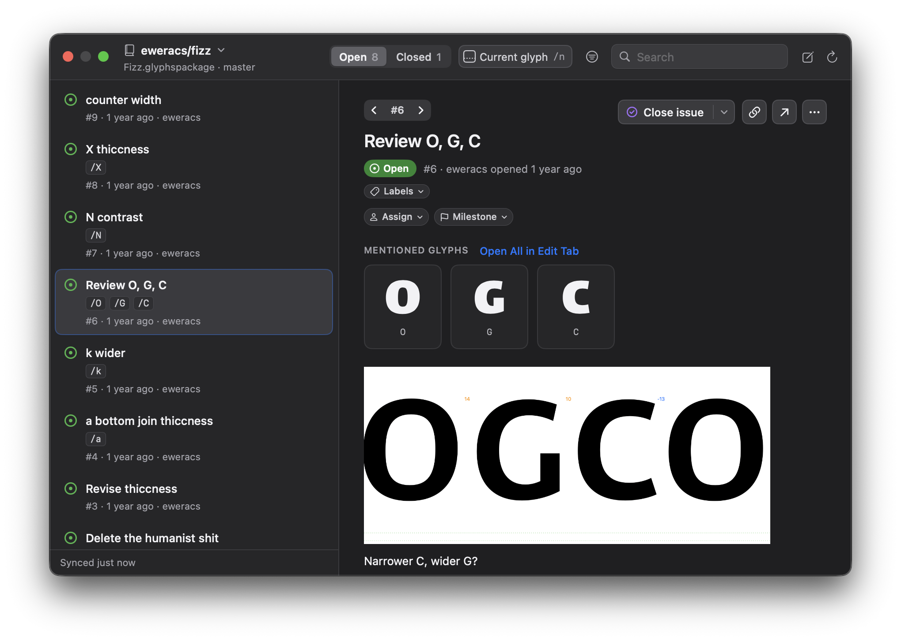

# GitHub Issues for Glyphs

A plugin for Glyphs that shows the GitHub issues of the
font you're working on in a floating panel. Open it with **Window → GitHub
Issues**.



## Install

1. Open up the plugin manager in Glyphs. Search for GitHub Issues and install the plugin.
2. Relaunch Glyphs.

The plugin is automatically updated through the plugin manager. Needs macOS 13 or later.

- **Automatic repository detection.** If your Glyphs file is in a git repository, the plugin finds the remote and pulls its issues automatically. You can also define a custom remote.
- **Knows about glyphs.** Glyph names (with or without a `/`) in an issue are automatically detected. Click a glyph chip to open it in a new Edit tab. Names count when they are:
  - written in slash notation anywhere (`/adieresis`, `/T/o`, `/a.ss01`), or
  - plain words in the title that are glyph names in the font ("k wider", "N contrast", "Dieresiscomb too small").
  Only names that exist in the font count.
- **Reference a master.** `@Bold/a/b` means `a` and `b` in the master Bold. Spaces and other characters in a master's name are written as hyphens (`@Bold-Italic/a` for “Bold Italic”).
  Case doesn't matter. Glyphs after a master the font doesn't have are disregarded.
- **Current glyph filter.** Shows only issues about the glyph you're editing: issues that mention it, one of its variants (`a.ss01` for `a`), or a glyph that uses it as a component (`adieresis` for `a`).
- **New activity.** A dot marks issues that changed since you last opened them in the panel.
- **Step through issues.** **‹ #9 ›** above an issue (or ⌥⌘← and ⌥⌘→) goes to the previous or next issue. ↑ and ↓ go through the list as filtered (see **Keyboard**).
- **Suggestions while typing.** `@` suggests the font's masters and people, `#` issues and `/` glyph names from the font.

Commenting, closing, editing, creating and adding images need a sign-in (see below).

## Keyboard

| Key | |
| --- | --- |
| ↑ ↓ | in the list: the next/previous issue. |
| Return | open the highlighted issue. With an issue open, go to its comment box |
| Esc | One hierarchical layer up. |
| ⌘↩ | post the comment, save the edited comment or issue, or create the issue |
| ⇧⌘↩ | close the issue, or reopen it, posting the comment if there is one |
| ⌥⌘← ⌥⌘→ | the previous/next issue |
| ⌘F | search |
| ⌘N | new issue |
| ⌘R | refresh |

## Signing in

Public repositories work without signing in. For private repositories, or to raise that limit, the plugin
uses, in this order:

1. a token you pasted (**Paste Token…**), stored in your Keychain, or
2. your existing `gh` CLI login (`gh auth token`), if `gh` is installed.

Issues refresh every five minutes while the panel is open.

## Build & install

Requirements: the Glyphs version to build for (for its headers), Xcode or the
Xcode command-line tools, macOS 13 or later.

```sh
./build.command                     # builds build/Glyphs 3/GitHubIssuesG3.glyphsPlugin
./build.command install             # …and copies it into the Glyphs 3 Plugins folder
GLYPHS=4 ./build.command install    # the same for Glyphs 4: build/Glyphs 4/GitHubIssuesG4.glyphsPlugin
```

Restart Glyphs after installing. `GLYPHS_APP`, `GLYPHS_PLUGINS` and `ARCHS`
override the Glyphs app to compile against, the Plugins folder to install to,
and the architectures to build (default `arm64 x86_64`). The comment at the top
of `build.command` lists the rest. Releases are cut with `release.command` (see
[RELEASING.md](RELEASING.md)).

## Layout of the code

```
Sources/IssueCore/   platform-independent, unit-tested with `swift test`
  GitRepository.swift   finds the repository and its GitHub remote from .git files
  GitHubClient.swift    REST client: issues, labels, assignees, milestones, timeline, comments,
                        create/edit/close/reopen, image uploads, ETags; deletes issues through GraphQL
  ImageAttachment.swift an image to upload: type, size limit, markdown, placeholder
  GitHubModels.swift    issue, comment, label, milestone and user models
  References.swift      #12, SHAs, @people and addresses in issue text, linked as GitHub does
  CompletionQuery.swift the @person or @master, #issue or /glyph being typed, for suggestions
  Timeline.swift        timeline entries → activity items, merging, collapsing
  GlyphMentions.swift   glyph names (and masters) in issue text; relation to the current glyph
  MarkdownBlocks.swift  block-level markdown parsing for issue bodies
Plugin/              the Glyphs plugin (AppKit, SwiftUI, GlyphsCore)
  GitHubIssuesPlugin.swift    principal class, Window menu item
  IssuesPanelController.swift the floating NSPanel
  IssuesModel.swift           state: font, repository, issues, filters, selection
  GlyphsContext.swift         current font, glyph and master; outlines; Edit tabs
  GlyphsCompat.swift          the few Glyphs 3 / Glyphs 4 API differences
  TokenStore.swift            Keychain and gh CLI tokens
  Views/                      SwiftUI views
Tests/IssueCoreTests/
GitHubIssuesG3.glyphsPlugin  the released Glyphs 3 build, for the Plugin Manager
build.command        builds the plugin; release.command cuts a release
CHANGELOG.md         release notes; RELEASING.md describes the process
```

`build.command` compiles `Sources/IssueCore` and `Plugin` together with `swiftc`
against the headers inside Glyphs.app (GlyphsCore, and GlyphsApp in Glyphs 4)
and links with
`-undefined dynamic_lookup`. SwiftPM is only used to test the core.

## Limitations

- github.com only; GitHub Enterprise remotes aren't recognised.
- Images upload through the endpoint `gh issue comment --attach` uses (`uploads.github.com/user-attachments/assets`). GitHub documents the `gh` flag, not the endpoint itself. Videos can't be added from the panel.
- Loads up to 1,000 issues per repository (pull requests are left out).
- GitHub's REST timeline doesn't say which pull request closed an issue, or which issue a duplicate points to. The pull request shows as its own “mentioned this in” line. The duplicate line has no number.
- Glyphs posts no notification for selection changes, so the current glyph is polled while the panel is open, a few times a second.
